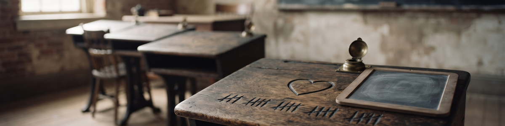

# codeintel-Hardcoded-Password-Detector

Night watch log treatment: the title is set in Bungee on a coffee black plate ruled as a night watch log giving the hour, with a small kettle beside this first part of the page only, and the kettle stays at punctuation size as the section marker throughout.

A command-line tool that scans code for hardcoded passwords and API keys using regex and entropy analysis. Found values are masked in console output and in the log file: reports show the file, key name, value length, and entropy, never the value itself. - Focused on Tools for static code analysis, vulnerability scanning, and code quality assurance

> **Watch log slip, on entropy.** Entropy does not act as a gate here: the two patterns decide the finds, every match is reported at once, and the entropy figure is a note added afterwards, warning past the threshold that a find may be a false positive.

## Install
`git clone https://github.com/ShadowStrikeHQ/codeintel-hardcoded-password-detector`

> **Watch log slip, flagged in place.** The install line above reads git clone https://github.com/ShadowStrikeHQ/codeintel-hardcoded-password-detector, naming ShadowStrikeHQ in place of ShadowGuard-AI. It is preserved exactly as printed and flagged here, never silently fixed.

## Usage
`./codeintel-hardcoded-password-detector [params]`

## Parameters
- `-h`: Show help message and exit
- `-v`: Enable verbose logging.
- `-e`: Entropy threshold for flagging potential secrets.  Defaults to 4.0.
- `-l`: Path to log file. If not provided, logs to stdout

## License
Copyright (c) ShadowStrikeHQ

> **Watch log slip, flagged in place.** The closing line above reads Copyright (c) ShadowStrikeHQ, while the repository LICENSE file carries the MIT License. Both stand as printed; neither is changed to suit the other.
